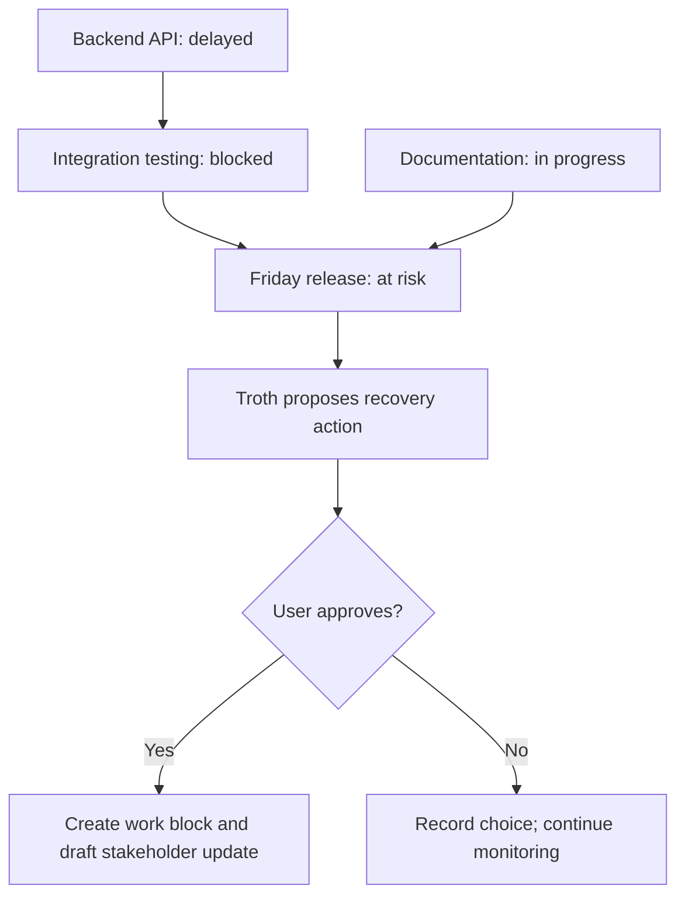

# Troth: Moat Strategy and Hackathon Blueprint

## Product positioning

**Troth: The Personal Commitment Intelligence Agent**

> An AI that doesn't just remember what you promised. It understands what your commitments depend on, learns how you work, and takes action before a promise is broken.

**Track:** Nebius x NVIDIA Global AI Hackathon, Personal AI Track  
**Primary target users:** Freelancers and professionals managing several simultaneous projects  
**Secondary users:** Working students, founders, project leads

## 1. Problem

Promises and obligations are scattered across emails, chats, meetings, notes, and documents. Traditional task managers rely on manual entry and generic reminders. They don't reliably understand dependencies between commitments, detect when circumstances change, or help users recover before a deadline is missed.

**Example:** A developer promises to deploy an application on Friday. Integration tests depend on an API delivered by a teammate. When the teammate reports a delay until Monday, an ordinary reminder still says "Deploy Friday." Troth identifies the dependency conflict and proposes an intervention.

## 2. What makes Troth different?

The differentiator is **Commitment Intelligence**, built from three layers:

1. **Understand:** Extract commitments, owners, deadlines, evidence, and dependencies into a persistent personal commitment graph.
2. **Predict:** Identify commitments at risk based on blockers, workload, approaching deadlines, and, when available, user-specific historical outcomes.
3. **Prevent:** Prepare useful interventions, request approval for sensitive actions, execute permitted workflows, and learn from confirmed outcomes.

The long-term moat is not the LLM prompt or a simple risk formula. It is the combination of **high-quality personal outcome history, evidence-backed dependency relationships, workflow integration, and trust earned through consistently useful intervention**.

## 3. Six possible moats

| Moat | What it does | Why it matters | Long-term defensibility |
|---|---|---|---|
| **Personal Commitment Graph** | Links promises to people, projects, prerequisite tasks, deadlines, and source messages | Detects problems that isolated task lists miss | Medium |
| **Personal Reliability Model** | Learns from estimates, actual completion times, delays, and user corrections | Adapts risk assessments to an individual's working patterns | Potentially high with real historical data |
| **Promise Failure Prevention** | Finds the cause of risk and proposes a targeted recovery action | Moves beyond reminders toward proactive assistance | Medium to high with strong execution |
| **Relationship-Aware Follow-ups** | Applies user-approved tone and timing preferences for different contacts | Makes agent actions more context-sensitive | Medium |
| **Private, Portable Memory** | Lets users inspect, edit, export, delete, and restrict personal memories | Supports user trust and the Personal AI theme | Trust advantage, technically replicable |
| **Outcome-Based Improvement** | Tracks which recommendations were accepted and actually helped | Improves intervention selection over time | Potentially high once validated |

**Priority:** Focus first on the graph, risk detection, and proactive intervention. Reliability learning is a stretch feature unless sufficient outcome data is available.

## 4. Commitment graph example

**Why this is powerful:** When an upstream dependency changes, Troth updates the affected commitments and can intervene without the user having to rediscover the implications manually.

## 5. Commitment Risk Engine

Start with an **explainable heuristic risk score**, not an unsupported claim that the system has learned a calibrated probability of failure.

Possible inputs:

- Time remaining until deadline
- Estimated work remaining
- Availability and schedule conflicts
- Number and severity of blockers
- Dependency status
- Historical delays on similar tasks, if supported by enough data

Example output:

> **Release at risk:** Integration testing is blocked because the backend API is delayed. Friday's deadline is unlikely to be practical under the current dependencies. Suggested action: ask for an updated API delivery estimate and prepare an early status update for the release stakeholder.

### Important implementation rules

- Always provide **reasons and source evidence** for risk flags.
- Label scores as heuristic unless calibrated against real completion outcomes.
- Do not infer that a task is incomplete solely because the system saw no completion message.
- Ask for confirmation when task ownership, due dates, or status are ambiguous.
- Distinguish a recommendation from an action actually executed.

Over time, compare a personalized model against a baseline to determine whether historical user data truly improves predictions.

## 6. Personal AI architecture

| Layer | Suggested technology | Responsibility |
|---|---|---|
| UI | Next.js, Tailwind CSS | Dashboard, commitment graph, review and approval controls |
| Backend | FastAPI | Ingestion, APIs, orchestration |
| LLM | NVIDIA open-source Nemotron model via Nebius Token Factory | Extract structured commitments, interpret changes, plan interventions |
| Agent execution | OpenShell / NemoClaw, where practical | Governed, sandboxed tools and policy enforcement |
| Memory | PostgreSQL + pgvector | Persistent commitments, source evidence, retrieval |
| Scheduling | APScheduler or Nebius Serverless Jobs | Deadline and blocker checks |
| Integrations | Email/calendar connectors or imported demo data | Gather user-authorized context and execute approved actions |
| Deployment | Nebius infrastructure | Host the working application / inference in compliance with the event's stated requirements |

### Minimum data entities

- `Source`: origin, timestamp, reference, permissions
- `Commitment`: description, owner, due date, status, confidence, source evidence
- `Dependency`: upstream commitment, downstream commitment, type, evidence
- `RiskAssessment`: score, factors, explanation, assessed time
- `Intervention`: proposed action, approval status, execution result
- `Outcome`: confirmed completion, delay, user feedback, observed effectiveness
- `UserPolicy`: allowed sources, permitted tools, confirmation requirements

### Privacy principles

- User selects which sources to import or connect.
- Minimize the information sent to hosted inference services.
- Do not claim local-only privacy when hosted model endpoints receive content.
- Encrypt sensitive stored data where applicable.
- Require confirmation before sending messages or making consequential external changes.
- Show action audit logs and provide memory editing, exporting, and deletion.

## 7. Hackathon MVP priorities

### Must have

- [ ] Import synthetic or user-approved conversations.
- [ ] Extract promises, dates, owners, and supporting snippets with Nemotron on Nebius.
- [ ] Allow users to verify or correct extracted commitments.
- [ ] Save commitments across sessions in persistent storage.
- [ ] Link at least one multi-step dependency chain.
- [ ] Process an incoming change and update affected commitments.
- [ ] Run an automatic risk check with explainable reasons.
- [ ] Draft one meaningful recovery intervention.
- [ ] Require approval before consequential external actions.
- [ ] Log what the agent proposed, what was approved, and what actually happened.
- [ ] Provide a simple way to review or delete memory.

### Stretch goals

- [ ] Personalized risk scoring from historical task outcomes.
- [ ] Relationship-aware communication preferences.
- [ ] More than one real integration.
- [ ] Measure intervention quality against a baseline.
- [ ] Restrict tools with policy-based sandbox execution.

## 8. Flagship demo script

1. **Import:** Show sample conversations containing three commitments.
2. **Understand:** Nemotron detects commitments, deadlines, and a dependency chain; the user verifies them.
3. **Remember:** Restart the application; the commitment graph persists.
4. **Detect change:** Introduce a new message: "The backend API won't be ready until Monday."
5. **Predict:** Without an explicit chat prompt, Troth flags the Friday release as at risk, citing the dependency.
6. **Prevent:** It proposes an updated work plan and drafts a stakeholder message.
7. **Approve and act:** User approves creating a calendar block or saving/sending an approved message.
8. **Audit:** Show the action history, source evidence, and user-controlled memory.

**Demo moment to emphasize:** The agent connects a new fact to an old promise, recognizes the downstream risk, and helps the user take preventive action.

## 9. Measurement and evaluation

| Measure | What to evaluate |
|---|---|
| Commitment precision and recall | Correct detection versus false positives and missed promises |
| Deadline extraction accuracy | Correct dates, time zones, and ambiguity handling |
| Dependency quality | Correct linkage and direction of prerequisite relationships |
| Risk detection | Whether actual blockers and timing changes are flagged |
| Intervention usefulness | User ratings / acceptance, not just number of drafts generated |
| Permission compliance | Whether prohibited actions are blocked and approval is enforced |
| Memory persistence | Whether commitments remain correct across sessions and restarts |

For a hackathon, use **clearly identified synthetic test scenarios** and display measured results only after running tests. Avoid presenting simulated risk scores as empirically validated probabilities.

## 10. Strategic positioning

### What Troth should not try to be

- Another general-purpose AI chatbot
- A task manager that only imports tasks from email
- A generic reminder app
- A broad personal agent that claims to handle every workflow

### What Troth should own

**Preventing important personal and professional commitments from failing.**

That narrow problem offers a distinct story, measurable technical behavior, meaningful agentic action, and a plausible path toward long-term defensibility as users build their own contextual histories.

## 11. One-sentence pitch

**Troth is a privacy-conscious personal agent that maps your promises, detects when dependencies put them at risk, and helps you take action before you let someone down.**

---

*Planning document for the Nebius x NVIDIA Global AI Hackathon. Product claims, model availability, infrastructure choices, and submission requirements should be verified during implementation.*
